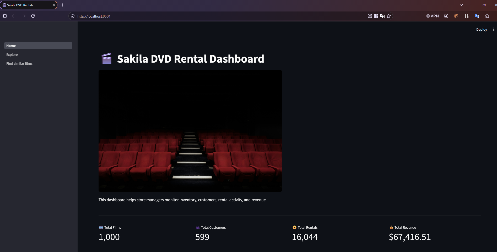
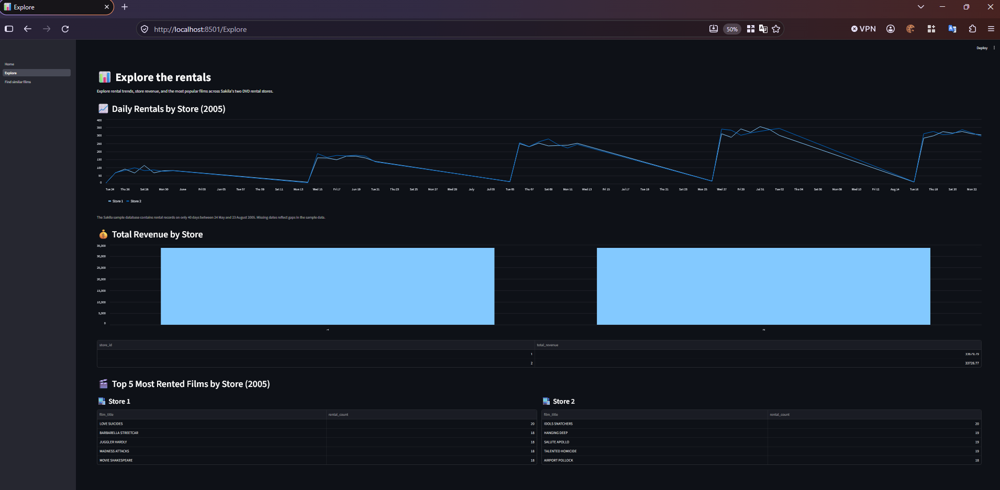
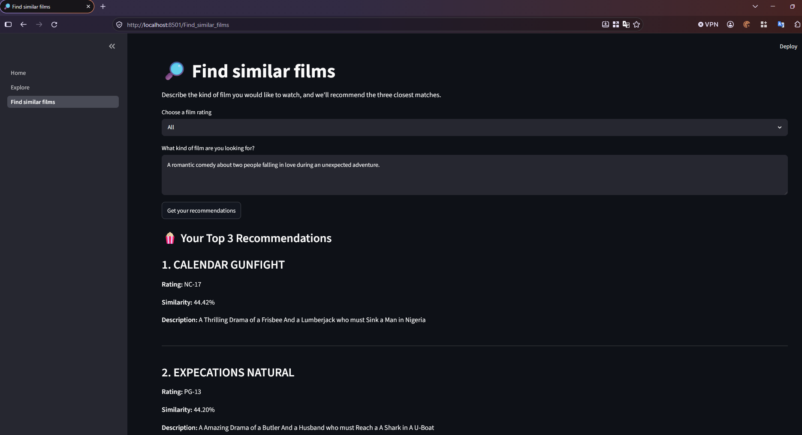

# Sakila DVD Rental Dashboard

An interactive Streamlit dashboard for exploring the Sakila DVD rental database and recommending films using semantic similarity.

## Features

**1. Home Page**

The homepage provides an overview of the DVD rental business, including the total number of films, customers, rentals, and total revenue.



**2. Explore Page**

The Explore page visualises daily rentals by store in 2005, compares total revenue across stores, and displays the five most frequently rented films for each store.



**3. Film Recommendation Page**

The recommendation system uses the `all-MiniLM-L6-v2` Sentence Transformer model to identify the three films most semantically similar to a customer's description.

It uses normalised embeddings and cosine similarity, with caching to avoid repeated embedding calculations.

An optional film rating filter allows users to restrict recommendations to their preferred rating.



## Technologies

- Python
- Streamlit
- SQLite (Sakila Database)
- Pandas and NumPy
- Sentence Transformers
- Semantic similarity search

## Running the Application

Install the required dependencies and navigate to the `your-code` directory.

Run:

```bash
streamlit run Home.py
```

The application opens locally at `http://localhost:8501`.